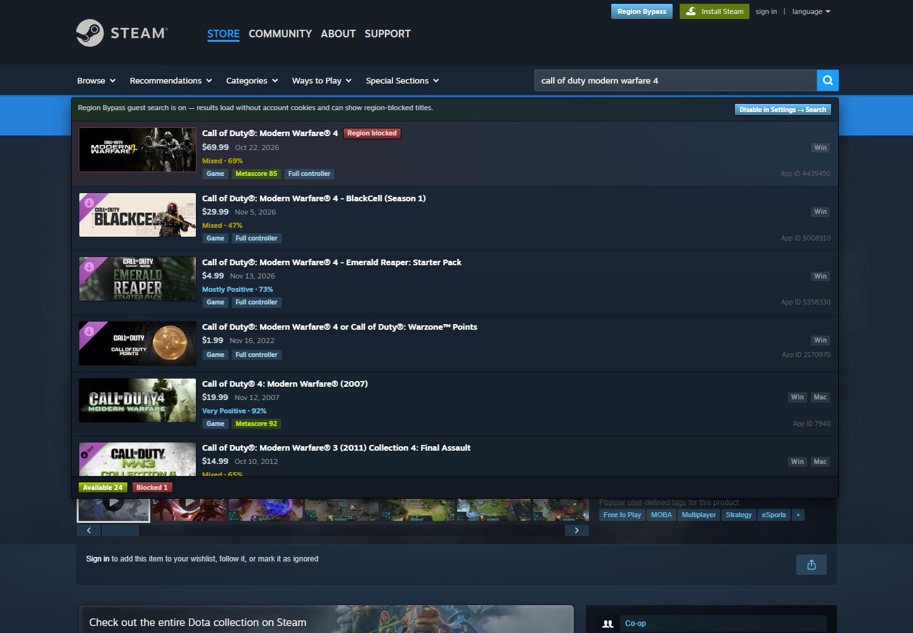

# Steam Region Block Bypass

[English](README.md) · [Русский](README.ru.md) · [简体中文](README.zh-CN.md) · [Español](README.es.md) · [Português (Brasil)](README.pt-BR.md) · [Deutsch](README.de.md) · **Français** · [日本語](README.ja.md) · [한국어](README.ko.md) · [Polski](README.pl.md)

[](https://raw.githubusercontent.com/NemoKing1210/steam-region-block-bypass/main/steam-region-block-bypass.user.js)
[](LICENSE)
[](CHANGELOG.md)

Un userscript pour la boutique Steam qui restaure les **pages de produit bloquées** et ajoute une **recherche invité** facultative — des suggestions de recherche anonymes dans l'en-tête, ainsi qu'une page `/search` invité activable séparément, sans cookies de compte.

Il recharge les URL des applications **sans cookies de compte** (vue invité), transpose la vraie mise en page de la boutique dans le document actif et restaure les contrôles liste de souhaits, suivre et ignorer pour les utilisateurs connectés après la transposition. Les **suggestions de recherche invité** sont activées par défaut ; le mode invité complet de la **page `/search`** est désactivé par défaut (à activer dans Region Bypass → Recherche). Pour les blocages basés sur l'IP, une **passerelle proxy** facultative peut être configurée depuis le panneau de réglages au style Steam (menu du compte → Réglages Region Bypass).

Compatible avec [Tampermonkey](https://www.tampermonkey.net/), [Violentmonkey](https://violentmonkey.github.io/), [Greasemonkey](https://www.greasespot.net/), ScriptCat et les autres gestionnaires prenant en charge le bloc de métadonnées `// ==UserScript==`.

## Captures d'écran

Le userscript réel exécuté sur une page de la boutique Steam en direct.


| | |
|---|---|
| <br>**Général** — langue de l'interface, contournement auto/manuel, bannière, pays de la boutique, notifications toast | <br>**Recherche** — suggestions invité, page `/search` facultative, registre des jeux bloqués, sondage |
| <br>**Cache** — jauge d'utilisation, TTL, limite d'entrées, cache par source, liste des bloqués | <br>**Passerelle proxy** — mode d'URL, hôte/port, authentification HTTP Basic facultative |

Suggestions de recherche invité dans l'en-tête de la boutique — **Call of Duty: Modern Warfare 4** est signalé comme **bloqué par région**, tandis que les autres résultats restent disponibles :



## Installation rapide

1. Installez un gestionnaire de userscripts (Tampermonkey ou Violentmonkey recommandés).
2. Cliquez sur le lien d'installation ci-dessous — votre gestionnaire devrait ouvrir une fenêtre d'installation.

**URL d'installation :**

```
https://raw.githubusercontent.com/NemoKing1210/steam-region-block-bypass/main/steam-region-block-bypass.user.js
```

[](https://raw.githubusercontent.com/NemoKing1210/steam-region-block-bypass/main/steam-region-block-bypass.user.js)

### Installation depuis une URL (tableau de bord)

| Gestionnaire | Chemin |
|---------|------|
| Tampermonkey | Tableau de bord → **Utilitaires** → **Installer depuis une URL** |
| Violentmonkey | Tableau de bord → **+** → **Installer depuis une URL** |
| Greasemonkey | Menu de l'extension → **Nouveau script utilisateur** → collez l'URL brute |

Collez l'[URL d'installation](#installation-rapide) ci-dessus.

### Installation manuelle

1. Ouvrez [`steam-region-block-bypass.user.js`](steam-region-block-bypass.user.js) dans ce dépôt.
2. Copiez l'intégralité du contenu du fichier.
3. Dans votre gestionnaire de userscripts, créez un nouveau script et collez le code.
4. Enregistrez et activez le script.

## Mises à jour

Le script inclut les métadonnées `@updateURL` et `@downloadURL` pointant vers le fichier brut GitHub, de sorte que les gestionnaires compatibles vérifient automatiquement les mises à jour. Les étapes de publication se trouvent dans [DEVELOPMENT.md](docs/DEVELOPMENT.md#releasing).

## Fonctionnalités

- **Restaure les pages d'application bloquées par région** — requête invitée anonyme, puis la vraie mise en page de la boutique est transposée dans le document actif (réécriture complète du document uniquement en solution de secours)
- **Préserve votre session** — les contrôles liste de souhaits, suivre et ignorer pour les utilisateurs connectés continuent de fonctionner après une transposition
- **Contournement automatique ou proposition manuelle** — s'exécute immédiatement sur les pages bloquées, ou affiche d'abord une proposition
- **Suggestions de recherche invité** — activées par défaut : suggestions anonymes dans l'en-tête de la boutique, avec les jeux bloqués enregistrés mis en évidence
- **Page `/search` invité** — facultative : rechargement et injection anonymes des résultats de recherche
- **Registre des jeux bloqués** — mémorise les ID d'applications bloquées par région et peut les détecter automatiquement lors du sondage des résultats de recherche
- **Contrôles du cache** — jauge d'utilisation, TTL et limite d'entrées, interrupteurs par source et navigation dans les pages en cache
- **Passerelle proxy** — relais HTTP facultatif pour les blocages basés sur l'IP ([configuration](docs/ARCHITECTURE.md#proxy-gateway))
- **Panneau de réglages au style Steam** — pages Général / Recherche / Cache / Proxy / À propos, édition de brouillon, Enregistrer et Enregistrer et recharger
- **10 langues d'interface** — anglais, russe, chinois, espagnol, portugais (Brésil), allemand, français, japonais, coréen, polonais

## Pages prises en charge

| Site | Modèle d'URL | Remarques |
|------|-------------|-------|
| Boutique Steam (applications) | `https://store.steampowered.com/app/{id}/…` | Contournement de l'erreur de région (usage principal) |
| Boutique Steam (recherche) | Recherche de l'en-tête + `https://store.steampowered.com/search/?term=…` | **Suggestions de recherche invité** et **page /search invité** facultative dans Region Bypass → Recherche |

Les pages d'application fonctionnent lorsque Steam affiche **« This item is currently unavailable in your region »** (cet article n'est pas disponible dans votre région) — par exemple **Call of Duty: Modern Warfare 4** dans les régions restreintes. Les **suggestions de recherche invité** sont activées par défaut pour la barre de recherche de l'en-tête ; la page `/search` invité est **facultative** dans **Region Bypass → Recherche**. Les deux utilisent la même pile de requêtes anonymes (proxy / `cc` / cache). Les ID d'applications bloquées enregistrés peuvent être mis en évidence dans les résultats de recherche.

## Pour les développeurs

Cette section a été déplacée vers des guides dédiés :

- [DEVELOPMENT.md](docs/DEVELOPMENT.md) — build, tests locaux, publication, passerelle
- [ARCHITECTURE.md](docs/ARCHITECTURE.md) — fonctionnement du contournement, structure du dépôt, métadonnées, autorisations, référence des réglages
- [CONTRIBUTING.md](CONTRIBUTING.md) — flux de contribution et checklist de PR
- [AGENTS.md](AGENTS.md) — instructions pour les agents de codage IA
- [SECURITY.md](SECURITY.md) — politique de sécurité et signalement privé
- [DESIGN.md](DESIGN.md) — langage visuel et règles des tokens CSS

## Autres userscripts

Autres userscripts du même auteur :

| Userscript | Ce qu'il fait |
|:-----------|:-------------|
| [](https://github.com/NemoKing1210/steam-plus) | Panneau de réglages complet et traduction à la volée pour le contenu de la boutique Steam et de la communauté Steam — descriptions de jeux, évaluations, commentaires de profil, actualités et guides |
| [](https://github.com/NemoKing1210/steam-gamestatus) | Ajoute les données de [GameStatus.info](https://gamestatus.info) à Steam — protection, dates de sortie, scores et configuration matérielle sur les fiches et pages de jeux |

## Avertissement

Ce projet **n'est pas affilié** à Valve ni à Steam. Contourner les restrictions géographiques peut enfreindre le [Contrat d'abonné Steam](https://store.steampowered.com/subscriber_agreement/). Utilisez-le à vos propres risques. Le script est destiné à **consulter** des informations de la boutique que Steam fournit déjà aux visiteurs anonymes ; il n'achète ni n'active de produits.

## Licence

[MIT](LICENSE) — Copyright (c) 2026 NemoKing
